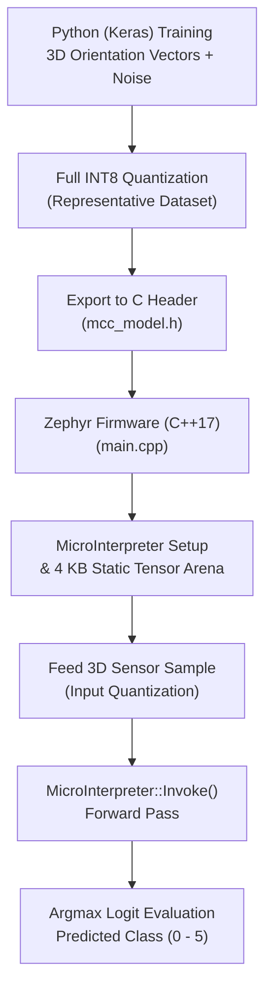

# Zephyr RTOS Multi-Class Classification TinyML Demo (`mcc`)

This project demonstrates an **End-to-End Multi-Class Classification (MCC) TinyML Pipeline** in Zephyr RTOS. It trains a 3D spatial orientation / accelerometer classification neural network in Python with TensorFlow/Keras, quantizes it to INT8 precision, and deploys it on embedded hardware using **TensorFlow Lite for Microcontrollers (TFLM)** and C++17.

---

## Overview

In IoT and wearable applications (e.g., smart watches, asset trackers, motion sensors), determining physical orientation from a 3-axis accelerometer $(x, y, z)$ is a classic machine learning task. Rather than using complex heuristic thresholds, an on-device neural network performs robust multi-class classification across 6 standard spatial orientations.

This demo demonstrates:
- **Full TinyML Lifecycle**:
  1. **Synthetic Dataset Generation & Training ([mcc.py](file:///home/bava/Desktop/ZephyrRTOS_Tutorial/mcc/model_src/mcc.py))**: Synthesizes 3,000 noisy accelerometer vector readings ($\sigma=0.15$) across 6 spatial orientation classes, compiles a multi-layer perceptron (MLP) with `SparseCategoricalCrossentropy`, and trains to high accuracy.
  2. **INT8 Quantization & C Array Export ([mcc_model.h](file:///home/bava/Desktop/ZephyrRTOS_Tutorial/mcc/src/mcc_model.h))**: Calibrates the model with a representative dataset using `TFLITE_BUILTINS_INT8`, quantizes inputs and outputs to `int8`, and exports the model directly as a C byte array (`g_model[]`, 2,496 bytes).
  3. **On-Device Embedded Inference ([main.cpp](file:///home/bava/Desktop/ZephyrRTOS_Tutorial/mcc/src/main.cpp))**: A C++17 Zephyr application executing real-time classification with a 4 KB static tensor arena, hardware abstraction initialization, input quantization, forward pass execution, and argmax class extraction.
- **Classification Target Classes**:
  - **Class 0 (+Z)**: `[ 0.0,  0.0,  1.0]` $\to$ Face Up / Flat
  - **Class 1 (-Z)**: `[ 0.0,  0.0, -1.0]` $\to$ Face Down
  - **Class 2 (+Y)**: `[ 0.0,  1.0,  0.0]` $\to$ Upright / Portrait Top
  - **Class 3 (-Y)**: `[ 0.0, -1.0,  0.0]` $\to$ Upside Down / Portrait Bottom
  - **Class 4 (+X)**: `[ 1.0,  0.0,  0.0]` $\to$ Landscape Right
  - **Class 5 (-X)**: `[-1.0,  0.0,  0.0]` $\to$ Landscape Left

---

## Directory Structure

```text
mcc/
├── CMakeLists.txt         # CMake build rules for C++17 application
├── prj.conf               # Kconfig options (C++17, TFLM, 8 KB stack size)
├── README.md              # Module documentation & TinyML classification workflow
├── model_src/
│   └── mcc.py             # Python script: Dataset synthesis, training, INT8 quantization & C header export
└── src/
    ├── main.cpp           # Embedded C++17 inference & argmax classification loop
    └── mcc_model.h        # Exported FlatBuffer byte array (g_model[])
```

---

## End-to-End TinyML Pipeline



---

## Model Architecture ([mcc.py](file:///home/bava/Desktop/ZephyrRTOS_Tutorial/mcc/model_src/mcc.py))

The neural network is trained using TensorFlow / Keras with the following layer topology:

| Layer | Type | Units / Activation | Output Shape | Parameters |
| :--- | :--- | :--- | :--- | :--- |
| Layer 1 | Input | $3$ features ($x, y, z$) | `(None, 3)` | 0 |
| Layer 2 | Dense (Fully Connected) | $16$ units, ReLU | `(None, 16)` | 64 |
| Layer 3 | Dense (Output) | $6$ units, Linear Logits | `(None, 6)` | 102 |

### Quantization & Header Generation
```python
converter = tf.lite.TFLiteConverter.from_keras_model(model)
converter.optimizations = [tf.lite.Optimize.DEFAULT]
converter.target_spec.supported_ops = [tf.lite.OpsSet.TFLITE_BUILTINS_INT8]
converter.inference_input_type = tf.int8
converter.inference_output_type = tf.int8
converter.representative_dataset = representative_dataset

tf_lite_model = converter.convert()
```
The resulting model binary is 2,496 bytes and is saved into [mcc_model.h](file:///home/bava/Desktop/ZephyrRTOS_Tutorial/mcc/src/mcc_model.h) as `g_model[]`.

---

## Embedded C++ Inference Engine ([main.cpp](file:///home/bava/Desktop/ZephyrRTOS_Tutorial/mcc/src/main.cpp))

### 1. Static Tensor Arena
All memory required by the model graph, activations, and scratch buffers is allocated statically at compile-time:
```cpp
constexpr int kTensorArenaSize = 4096; /* 4 KB */
alignas(16) static uint8_t tensor_arena[kTensorArenaSize];
```

### 2. MicroInterpreter Registration
```cpp
const tflite::Model *model = tflite::GetModel(g_model);

static tflite::MicroMutableOpResolver<1> resolver;
resolver.AddFullyConnected();

tflite::MicroInterpreter interpreter(model, resolver, tensor_arena, kTensorArenaSize);
interpreter.AllocateTensors();

TfLiteTensor *input = interpreter.input(0);
TfLiteTensor *output = interpreter.output(0);
```

### 3. Input Quantization & Argmax Inference
3D sensor readings ($x, y, z$) are mapped to INT8 using the input tensor quantization parameters, fed to the interpreter, and evaluated via argmax:
```cpp
/* Quantize 3D sensor floats -> int8 */
input->data.int8[0] = (input_x / in_scale) + in_zero_point;
input->data.int8[1] = (input_y / in_scale) + in_zero_point;
input->data.int8[2] = (input_z / in_scale) + in_zero_point;

/* Run inference forward pass */
interpreter.Invoke();

/* Find highest scoring class (Argmax) */
int max_score = -128;
int best_class = 0;
for (int i = 0; i < 6; i++) {
    if (output->data.int8[i] > max_score) {
        max_score = output->data.int8[i];
        best_class = i;
    }
}
```

---

## Kconfig Configuration ([prj.conf](file:///home/bava/Desktop/ZephyrRTOS_Tutorial/mcc/prj.conf))

- `CONFIG_CPP=y`: Enables Zephyr C++ compiler support.
- `CONFIG_STD_CPP17=y`: Configures compiler to C++17 standard (required by modern TFLM).
- `CONFIG_REQUIRES_FULL_LIBC=y`: Enables complete C standard library support.
- `CONFIG_TENSORFLOW_LITE_MICRO=y`: Links the TensorFlow Lite for Microcontrollers framework.
- `CONFIG_MAIN_STACK_SIZE=8192`: Allocates 8 KB stack to the main thread for model initialization and execution.
- `CONFIG_LOG=y`, `CONFIG_LOG_DEFAULT_LEVEL=3`: Enables the Zephyr logging subsystem with INF-level logging.

---

## How to Build and Run

From the root of your Zephyr RTOS workspace:

### 1. Build for QEMU Simulator (`qemu_cortex_m3`)
```bash
west build -p always -b qemu_cortex_m3 mcc
```

### 2. Run in QEMU Simulator
```bash
west build -t run
```

### 3. Build & Flash for Physical Hardware (e.g., STM32 / ESP32 / nRF52840)
```bash
west build -p always -b <your_board_name> mcc
west flash
```

---

## Expected Output

```text
*** Booting Zephyr OS build v3.7.0 ***
[00:00:00.000,000] <inf> tflite_mcc: Starting MCC Inference
```
